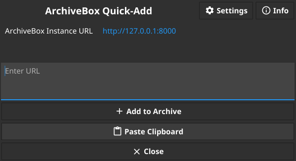
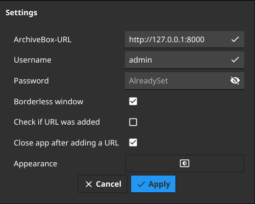

# ArchiveBox QuickAdd

**A simple utility application to quickly archive URLs with an existing
[ArchiveBox](https://github.com/ArchiveBox/ArchiveBox/) instance in the background, without interrupting your work.**

Version: 2.0


Developed with [Go](https://go.dev/) using the [Fyne](https://fyne.io) toolkit.
This software is primarily tested on Linux.

## Install

The easiest way to get the app is to download a prebuilt archive for your platform
from [GitHub Releases](https://github.com/emschu/archivebox-quick-add/releases)
(Linux, Windows, FreeBSD and macOS builds, with SHA256 checksums). The archives
include the app and its metadata, so no Go toolchain is needed.

Alternatively, install from source. This needs Go 1.26 or newer, a C compiler and,
on Linux, the OpenGL/X11 development packages (see [AGENTS.md](./AGENTS.md) for the
full list):

```console
$ go install github.com/emschu/archivebox-quick-add@latest
```

Or use the Fyne CLI, which installs the app with its icon and desktop metadata:

```console
$ go install fyne.io/tools/cmd/fyne@latest
$ fyne install github.com/emschu/archivebox-quick-add
```

## Quick start

1. Open **Settings** (gear icon) and set **ArchiveBox-URL** to your instance,
   e.g. `http://127.0.0.1:8000`.
2. Create an API key for your user in the ArchiveBox admin interface at
   `/admin/api/apitoken/` and paste it into the **API Key** field. Settings take
   effect immediately; no restart is needed.
3. Paste or type an `http(s)` URL into the input field. If the clipboard holds a
   valid URL at startup, the field is pre-filled automatically; the **Paste Clipboard**
   button fills it on demand.
4. Press **Enter** or **Ctrl+Return**, or click **Add to Archive**. A desktop
   notification confirms that the URL was submitted.

The app can close itself after a successful submission and show a confirmation
notification; both are enabled on first run and can be changed in Settings.

## Features

- Uses ArchiveBox's official REST API with API-key (Bearer token) authentication.
- Quickly archives a URL from the keyboard or the clipboard.
- Confirmation notification after submission (enabled on first run).
- Closes automatically after archiving (enabled on first run).
- Customizable appearance via Fyne settings.
- English and German UI; translations are welcome.
- Have an idea or a question? [Open an issue](https://github.com/emschu/archivebox-quick-add/issues/new).

## Upcoming features

- Add tags to a URL.
- Select the archiving method instead of using all by default.
- Set the archiver depth.

## Screenshots

*Main window:*



*Settings dialog:*



## Contributing

If you find a bug or want to request new features, please use
[GitHub issues](https://github.com/emschu/archivebox-quick-add/issues).
Pull requests are welcome.

## License

The Fyne toolkit is licensed under the **BSD 3-Clause License**:

```text
Copyright (C) 2018 Fyne.io developers (see AUTHORS)
All rights reserved.
```

This app is distributed under the **GNU Affero General Public License v3**. See [LICENSE](./LICENSE) for more information.
